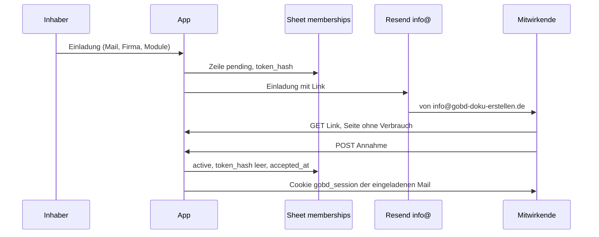

# Konzept: Rolle Mitwirkende

Stand 12.10.2026. Konzept, keine Umsetzung. Betrifft PhilCap-tech/Gobd, Produktion www.gobd-doku-erstellen.de.

Die Rolle **Mitwirkende** erlaubt einer eingeladenen Person, Module einer einzelnen Firma auszufüllen und Entwürfe zu speichern. Abo, Rechnungen und das Erzeugen einer PDF-Fassung bleiben beim Kontoinhaber.

## 1. Ausgangslage

Es gibt heute eine Identität und keine Rollen. Wer das Cookie `gobd_session` besitzt, handelt als die E-Mail in diesem Cookie und sieht jede Firma, die in der Tabelle `entities` auf diese E-Mail zeigt.

### 1.1 Anmeldung

| Gegenstand | Ist-Stand |
| --- | --- |
| Cookie | `gobd_session`, httpOnly, SameSite=Lax, in Produktion Secure, Pfad `/`, Lebensdauer 30 Tage |
| Signatur | HMAC-SHA-256 über Base64url-JSON, Geheimnis `MAGIC_LINK_SECRET` (`lib/auth.ts`) |
| Nutzlast der Sitzung | `typ: "session"`, `email`, `iat`, `exp`. Keine Firma, keine Rolle |
| Magic Link | `typ: "magic"`, nur `email` und `exp`, Gültigkeit 20 Minuten (`MAGIC_TTL_MS`) |
| Annahme | `GET /auth/verify?token=&next=` prüft die Signatur und setzt das Sitzungs-Cookie. Der Token ist bis zum Ablauf wiederverwendbar, eine `jti` gibt es nicht |
| Weitere Token-Arten | `checkout` (Cookie `gobd_checkout`, 6 Stunden, an eine Stripe-Checkout-Session gebunden). `mayIssueSessionCookie` lässt das Login-Cookie nur für den Kanal `magic` zu. Die erste erfolgreiche Intake-Lieferung setzt es zusätzlich, wenn dieser Checkout-Nachweis zur Inhaber-Mail passt (`applyCheckoutOwnerSession`) |
| Widerruf | Kein Sitzungsspeicher. `SESSION_MIN_ISSUED_AT` verwirft alle Cookies, deren `iat` davor liegt, also alle Nutzer auf einmal |
| Weiterleitung nach Login | `safeNextPath` erlaubt nur eine feste Pfadliste, dazu `/account/firma/<id>` und `/account/dokument/<id>` |
| Versand | Resend, Absender `EMAIL_FROM`. Die Impressum-Adresse ist `info@gobd-doku-erstellen.de`. Der Link steht nie in der HTTP-Antwort; ohne Resend nur im Server-Log, und nur außerhalb der Produktion |
| Rate-Limit | Auf `POST /api/auth/magic-link` keines |

### 1.2 Konto, Firma, Entwurf, PDF, Abo

| Gegenstand | Speicher | Besitz heute |
| --- | --- | --- |
| Profil | Sheet `profiles` (Fallback `.data/profiles.json`): `email`, `name`, `updated_at` | die Sitzungs-Mail |
| Firma | Sheet `entities`: `entity_id`, `user_email`, `name`, `street`, `zip`, `city`, `stnr`, `ust_id`, `created_at`, `updated_at` | `user_email`. Höchstens 5 Firmen (`MAX_ENTITIES_PER_ACCOUNT`). `getOwnedEntity` verlangt Gleichheit der Mail |
| Fassung | Sheet `intakes` (Umgebungsname `GOOGLE_SHEETS_TAB`): eine Zeile je Version, u. a. `email`, `entity_id`, `document_id`, `stripe_session_id`, `stripe_customer_id`, `version`, `pdf_url`, `changed_by`, `fragen` | `email` der Zeile. `changed_by` ist ein vom Kunden eingetippter Text, kein belegter Akteur |
| PDF | privater Blob `gobd/<familyId>/v<version>.pdf` | Download `GET /api/docs/[id]/download`, wenn die Sitzungs-Mail der Zeile entspricht oder die Query `session_id` zur Checkout-Session der Zeile passt |
| PDF erzeugen | `POST /api/intake` und `POST /api/document` („Speichern und PDF erzeugen“) | schreibt Blob, hängt eine Intake-Zeile an, versendet die Liefermail |
| Entwurf | privater Blob `gobd/drafts/<sha256-40>.json`, lokal ohne Token unter `.data/drafts/` | Schlüssel `email:<mail>:<entityId>:gesamt`, sonst `doc:`, `area:` oder `session:`. Der Blob wird überschrieben. Zugriff, wenn die Sitzungs-Mail der Mail im Entwurf oder im `email:`-Schlüssel entspricht |
| Upload | privater Blob `gobd/uploads/<owner>/…` | Owner-Segment aus der Mail bzw. der Checkout-Session |
| Abo | Stripe-Checkout `mode: subscription`, Preise Einrichtung 149 € und 49 €/Monat, Metadaten `entity_id` und `company`. Kunden-ID liegt auf den Intake-Zeilen | Portal und `/account/billing` lösen den Kunden über die Sitzungs-Mail auf |
| Große Zellen | Antworten über 49.000 Zeichen wandern in den Blob, die Zelle behält einen Zeiger | unverändert lassen |

Konflikt heute: der Client führt `revision`. Ist die gespeicherte Revision höher, antwortet `PUT /api/intake/draft` mit 409 und dem Server-Entwurf. Gleiche Revision wird angenommen. Der Blob kennt kein Compare-and-Swap. `withSessionWriteLock` reiht `POST /api/intake` pro Checkout-Session oder Dokument-ID hintereinander, nur im Speicher einer Instanz. Entwurf-PUTs laufen ohne diese Sperre.

Sheets sind die Quelle für Stammdaten und Fassungen, der Blob für Entwürfe, PDFs und Uploads. Eine Mitgliedschaft passt in dieses Muster: eine neue Sheet-Karteikarte, der Entwurf bleibt der bestehende Blob der Firma.

## 2. Zielbild

**Kontoinhaber** bleibt, wer die Firma angelegt hat (`entities.user_email`) und das Abo bezahlt. Daran ändert sich nichts.

**Mitwirkende** ist eine Mitgliedschaft, kein zweites Konto und kein zweiter Stripe-Kunde.

Eine Mitgliedschaft bindet genau eine E-Mail an genau eine `entity_id`. Die Person sieht die anderen Firmen des Inhabers nicht, auch wenn das Konto bis zu fünf Firmen hat.

### 2.1 Erlaubt

- Einladung per E-Mail annehmen und sich danach mit dem bestehenden Magic-Link-Login anmelden.
- Die eine Firma öffnen und die zugewiesenen Module im Intake ausfüllen.
- Entwürfe serverseitig speichern (derselbe Blob wie der Inhaber).
- Dateien zu einer zugewiesenen Frage hochladen, abgelegt unter dem Owner-Schlüssel des Inhabers.
- Die eigenen Einträge in der Änderungshistorie dieser Firma sehen.

### 2.2 Ausgeschlossen

- Abo anlegen, ändern oder kündigen. Kein Checkout, kein Kundenportal, keine Seite „Abo & Rechnungen“ für diese Firma.
- Rechnungen, Zahlungsdaten und die Stripe-Kunden-ID des Inhabers sehen oder verwenden.
- Eine PDF-Fassung erzeugen, herunterladen oder per Liefermail versenden. Das betrifft `POST /api/intake`, `POST /api/document`, den Modul-Export und `GET /api/docs/[id]/download`.
- Weitere Firmen anlegen, Stammdaten der Firma ändern, andere Personen einladen, das Profil des Inhabers ändern, ein Konto löschen.
- Den Betriebs-Check und den Modulstatus setzen (`tool`, „durch bestehende Dokumentation abgedeckt“, `offen`, „nicht vorhanden“). Das legt den Umfang der Verfahrensdokumentation fest und bleibt beim Inhaber.
- Über eine Checkout-`session_id` in der URL Zugriff auf Dokumente des Inhabers bekommen.

Hat die eingeladene Person ein eigenes bezahltes Konto, bleiben ihre eigenen Firmen, ihr eigenes Abo und ihre eigenen PDFs an ihrer eigenen Mail hängen. Die Mitgliedschaft fügt eine fremde Firma hinzu und öffnet nicht das Abo dieser fremden Firma.

### 2.3 Modulzuweisung

Optional. Leer bedeutet: alle Module, die der Inhaber für diese Firma aktiviert hat (`m01`–`m24` aus `lib/module/katalog.ts`). Gesetzt bedeutet: nur die genannten Modul-IDs, und auch die nur, soweit der Inhaber sie aktiviert hat. Eine Zuweisung schaltet kein abgeschaltetes Modul ein.

Die Prüfung sitzt auf dem Server. Ausgeblendete Fragen im Client sind keine Grenze. Ein `PUT` mit Antworten außerhalb der Zuweisung wird abgelehnt, nicht still auf den erlaubten Teil gekürzt, damit die Person den Konflikt sieht.

## 3. Datenmodell

Neue Sheet-Karteikarte `memberships` (Umgebungsname `GOOGLE_SHEETS_MEMBERSHIPS_TAB`, Default `memberships`). Dieselbe Tabelle und dasselbe Dienstkonto wie `entities`. Lokaler Fallback `.data/memberships.json`, auf Vercel unter `os.tmpdir()/gobd-data`, analog zu den bestehenden Karteikarten. Eine Zeile je Mitgliedschaft, bei Statuswechsel in place aktualisiert, wie Firmenzeilen mit derselben `entity_id` heute aktualisiert werden. Jede Statusänderung schreibt zusätzlich einen Audit-Eintrag.

### 3.1 Mitgliedschaft

| Spalte | Feld | Inhalt |
| --- | --- | --- |
| `membership_id` | `membershipId` | UUID, stabil |
| `owner_email` | `ownerEmail` | Mail des Kontoinhabers, normalisiert kleingeschrieben. Muss `entities.user_email` dieser Firma sein |
| `member_email` | `memberEmail` | Mail der eingeladenen Person |
| `entity_id` | `entityId` | genau eine Firma |
| `status` | `status` | `pending`, `active`, `revoked` |
| `module_ids` | `moduleIds` | kommagetrennt `m01`…`m24`, oder leer für alle aktiven Module. Höchstens 24 IDs, weit unter der Zellgrenze |
| `token_hash` | `tokenHash` | SHA-256 des Einladungs-Tokens, solange `pending`. Nach Annahme oder Widerruf leeren |
| `invited_at` | `invitedAt` | ISO-8601 |
| `accepted_at` | `acceptedAt` | leer bis zur Annahme |
| `revoked_at` | `revokedAt` | leer bis zum Widerruf |
| `invited_by` | `invitedBy` | Mail des Inhabers, der die Zeile angelegt hat |
| `updated_at` | `updatedAt` | letzte Änderung der Zeile |

Eindeutig ist das Paar (`member_email`, `entity_id`) unter den Status `pending` und `active`. Ein Widerruf gibt das Paar für eine neue Einladung frei; die alte Zeile bleibt `revoked` und wird nicht wiederverwendet.

`owner_email` ist absichtlich redundant zur Firma. Die Prüfung lautet: Firma existiert, `user_email` ist der Inhaber, und die Mitgliedschaft nennt denselben Inhaber. Ein verwaister `entity_id` allein berechtigt niemanden.

### 3.2 Einladungs-Token

Neue Art `typ: "invite"` in derselben HMAC-Hülle wie Magic Link und Sitzung. Felder: `membershipId`, `email` (die eingeladene Mail), `exp` (20 Minuten, dieselbe Frist wie `MAGIC_TTL_MS`), `jti` (Zufallswert, dessen Hash in `token_hash` steht).

Der Token ist ein Bearer für genau diese Mitgliedschaft. Er ist kein Sitzungs-Cookie und kein Login-Magic-Link. `GET /auth/verify` darf ihn nicht annehmen. Annahme nur über den eigenen Pfad in Abschnitt 4.

Ein neuer Versand erzeugt eine neue `jti` und überschreibt `token_hash`. Der vorherige Link stirbt damit, auch innerhalb der 20 Minuten.

### 3.3 Entwurf

Der Blob-Schlüssel bleibt der des Inhabers (`email:<owner>:<entityId>:gesamt` bzw. `doc:<documentId>`). Es gibt keinen zweiten Entwurf der Mitwirkenden. Sonst laufen zwei Stände auseinander, und die PDF-Fassung des Inhabers würde einen davon ignorieren.

Erweiterung des JSON `IntakeDraft` um `updatedBy` (Mail des letzten erfolgreichen Speicherns). `email` im Entwurf bleibt die Inhaber-Mail. `authorizeDraftAccess` lernt einen zweiten erfolgreichen Weg: Sitzungs-Mail hat eine aktive Mitgliedschaft, `draft.entityId` ist deren `entityId`, `draft.email` ist deren `ownerEmail`. Die Funktion gibt weiterhin die Inhaber-Mail als `ownerEmail` zurück, damit der Entwurf nicht auf die Mitwirkenden-Mail umgeschrieben wird.

Modulfilter vor dem Schreiben: jede Antwort-ID muss zu einem zugewiesenen und aktivierten Modul gehören. Dafür reicht der bestehende Katalog (`MODULE` in `lib/module/katalog.ts`).

### 3.4 Was unverändert bleibt

- `gobd_session` trägt weiter nur die Mail. Rolle und Firma werden bei jedem Zugriff aus `memberships` gelesen. Ein Cookie mit eingebauter Firmenliste wäre nach Widerruf oder nach einer Moduländerung bis zu 30 Tage falsch, und ein globales `SESSION_MIN_ISSUED_AT` ist dafür zu grob.
- PDF-Pfade, Intake-Zeilen und Stripe-Metadaten bekommen kein Mitgliedschaftsfeld.
- Uploads bleiben unter dem Owner-Segment des Inhabers. Ein Upload unter der Mitwirkenden-Mail würde beim Kontolöschen des Inhabers liegen bleiben und beim Löschen der Mitwirkenden fremde Dateien treffen können.

## 4. Abläufe



### 4.1 Einladen

1. Sitzung ist der Inhaber der gewählten Firma. `entityOwnedByEmail` muss gelten. Eine Mitwirkende lädt niemanden ein.
2. Mail prüfen (eine Adresse, kleingeschrieben). Die eigene Mail des Inhabers für dieselbe Firma ablehnen.
3. Liegt für das Paar schon `pending` oder `active`, keine zweite Zeile anlegen. Bei `pending` den Token erneuern und die Mail erneut senden.
4. Zeile `pending` schreiben, Token mit 20 Minuten erzeugen, nur den Hash speichern.
5. Mail versenden. Absender ist `info@gobd-doku-erstellen.de`. Der Betreff nennt die Firma und das Wort Einladung, der Link steht nur im Body. Schlägt Resend fehl, bleibt die Zeile `pending` ohne gültigen Hash, und die Oberfläche sagt den Fehlschlag. Die HTTP-Antwort enthält den Link nicht (dieselbe Regel wie `deliverLoginLink`).
6. Audit `invite.sent`.

Der Inhaber kann die Einladung erneut senden. Jeder Versand invalidiert den vorherigen Link.

Antwortadresse der Mail ist die Inhaber-Mail, damit Rückfragen ankommen. Die eingeladene Person sieht diese Adresse dadurch. Das ist gewollt, weil sie ohnehin an dieser Firma mitarbeitet.

`EMAIL_FROM` muss diese Absenderadresse sein, oder der Einladungsversand setzt `from` ausdrücklich auf `info@gobd-doku-erstellen.de`. Die Domain ist bei Resend bereits die Produktionsdomain; ein zweiter Absender wäre ein eigener Eintrag dort.

### 4.2 Annehmen

1. `GET /auth/invite?token=` prüft Signatur, Ablauf, Art `invite`, Mail und `jti` gegen `token_hash`, Status `pending`. Die Seite zeigt Firma (Name, keine Steuernummer), Inhaber-Mail und die Modulauswahl. Der GET verbraucht den Token nicht. Mail-Programme rufen Links vorab auf; ein Verbrauch beim GET würde die Einladung entwerten, bevor die Person klickt.
2. `POST` mit demselben Token bestätigt. Erst der POST leert `token_hash`, setzt `active` und `accepted_at`.
3. Das Sitzungs-Cookie wird für `member_email` gesetzt, mit dem bestehenden `createSessionToken`. Es wird nie für `owner_email` gesetzt.
4. Weiterleitung auf die Mitwirkenden-Ansicht dieser einen Firma. `next` aus der URL entfällt. Ein mitgeschicktes `next` wäre eine offene Weiterleitung in das Konto des Inhabers.
5. Audit `invite.accepted`. Der Inhaber erhält eine kurze Mail (Firma, angenommene Adresse, Zeitpunkt).

Abgelaufener oder bereits verbrauchter Token: dieselbe knappe Meldung, kein Hinweis, welche der beiden Ursachen gilt. Der Inhaber sendet neu.

Ist die Person schon mit einer anderen Mail angemeldet, endet die Annahme mit der Mail aus dem Token. Das entspricht dem heutigen Magic Link, der die Sitzung ebenfalls auf die Mail im Token stellt.

### 4.3 Arbeiten

Nach dem Login lädt das Konto zwei Mengen:

- Firmen mit `entities.user_email` = Sitzungs-Mail (eigene Firmen, kann leer sein).
- Mitgliedschaften mit `member_email` = Sitzungs-Mail und `status = active`.

Die Mitwirkenden-Ansicht einer Firma zeigt Modulübersicht, Intake und Entwurf. Sie zeigt kein Abo, keine Rechnung, keinen Button „Speichern und PDF erzeugen“, keinen Download, keinen Betriebs-Check, keine Firmendaten zum Bearbeiten, keine Einladung.

Jeder schreibende Aufruf lädt die Mitgliedschaft neu. Ein Cache über den Request hinaus würde einen Widerruf verzögern.

### 4.4 Widerrufen

Der Inhaber setzt `status = revoked`, `revoked_at = now`, `token_hash` leer. Pending-Links sterben sofort. Eine aktive Sitzung bleibt als Cookie gültig, der nächste Zugriff auf diese Firma findet keine aktive Mitgliedschaft und antwortet 403. Eigene Firmen dieser Mail bleiben erreichbar.

Der Entwurf bleibt. Er gehört der Firma. Offene Antworten der Mitwirkenden liegen dem Inhaber damit weiter vor.

Audit `invite.revoked`. Eine Mail an die bisherige Mitwirkende nennt die Firma und den Zeitpunkt, ohne Inhalte.

Moduländerung an einer aktiven Zeile ist kein Widerruf: `module_ids` aktualisieren, Audit `membership.modules_changed`. Die laufende Sitzung sieht die neue Liste beim nächsten Speichern.

### 4.5 Erneute Einladung

Nach `revoked` legt ein neues Einladen eine neue `membership_id` an. Die Historie der alten Zeile bleibt über das Audit und die widerrufene Zeile lesbar.

## 5. Risiken und Gegenmaßnahmen

### 5.1 Abfluss des Tokens

Der Link liegt in der Mail, in der Browser-Historie und in Zugriffs-Logs, solange er als Query-Parameter ankommt. Referer kann ihn an Dritte tragen, wenn die Annahmeseite etwas Externes lädt.

Gegenmaßnahmen: 20 Minuten, eine `jti`, Hash statt Token in der Tabelle, Verbrauch erst beim POST, Weiterleitung auf eine URL ohne Token, kein Token im Betreff, kein Token in der API-Antwort, kein vollständiger Verify-URL-Log in Produktion (der Dev-Fallback loggt heute die Login-URL und bleibt auf Einladungen ebenfalls auf Nicht-Produktion beschränkt). Die Annahmeseite lädt keine Dritt-Skripte. HMAC bleibt `MAGIC_LINK_SECRET`; ein zweites Geheimnis ist unnötig, solange die Art `invite` von `magic` getrennt geprüft wird.

### 5.2 Weiterleiten des Links

Wer den Link hat, kann die Mitgliedschaft annehmen und sitzt danach als die eingeladene Mail in der Sitzung. Das ist die Eigenschaft jedes Bearer-Links und gilt für den heutigen Magic Link genauso. Eine Bindung an ein Gerät gibt es nicht.

Gegenmaßnahmen: Einmalverwendung, kurze Frist, Bestätigungsseite mit lesbarer Mail und Firma, Mail an den Inhaber bei Annahme, Widerruf in einem Schritt. Die Oberfläche zeigt dauerhaft „Angemeldet als …, Mitwirkung bei …“. Ein weitergeleiteter Link erzeugt damit eine sichtbare Annahme, die der Inhaber zurücknehmen kann. Geteilte Postfächer kann die Anwendung nicht erkennen.

### 5.3 Zuschnitt der Sitzung

Das Cookie berechtigt heute zu allem, was der Mail gehört. Für eine Mitwirkende ohne eigene Firma ist das leer, und genau deshalb muss die fremde Firma über die Mitgliedschaft dazukommen. Dieselbe Stelle darf nicht die anderen Firmen des Inhabers dazunehmen.

Gegenmaßnahmen: jede Firmenaktion nennt eine `entity_id` und besteht nur, wenn entweder `entityOwnedByEmail` gilt oder genau eine aktive Mitgliedschaft dieser Sitzungs-Mail auf diese `entity_id` zeigt. Die Kontoübersicht listet Mitgliedschaften einzeln. Pfade `/account/billing`, `/billing`, `/checkout`, `/api/stripe/portal`, `/api/checkout` bleiben an der eigenen Mail. Sie lösen Stripe nie über eine `entity_id` auf, die nur per Mitgliedschaft erreichbar ist.

`POST /api/checkout` vertraut heute der Mail aus dem JSON-Body und prüft keine Sitzung. Die Mitwirkenden-Oberfläche bietet den Aufruf nicht an. Zusätzlich lehnt der Checkout eine `entity_id` ab, deren Inhaber nicht die Mail im Body ist. Sonst könnte eine eingeladene Person eine Checkout-Session auf die Firma des Inhabers starten.

### 5.4 Rechteausweitung

Der gefährliche Fehler ist, die Mitgliedschaft wie Eigentum zu behandeln. `canAccessDocument`, `authorizeDeliveredWrite`, `getOwnedEntity` und das Billing dürfen die Mitgliedschaft nicht als Eigentümer-Mail werten.

Gegenmaßnahmen, serverseitig und unabhängig von der Oberfläche:

| Aktion | Inhaber | Mitwirkende |
| --- | --- | --- |
| Entwurf lesen und schreiben, Upload in zugewiesenen Modulen | ja | ja, nur diese Firma und diese Module |
| Modulstatus, Betriebs-Check, Stammdaten, Firma anlegen | ja | nein |
| `POST /api/intake`, `POST /api/document`, PDF-Download, Liefermail | ja | nein |
| Billing, Portal, Checkout dieser Firma | ja | nein |
| Einladen, Widerruf, Modulzuweisung, Audit der Firma | ja | nein |
| Konto des Inhabers löschen, Profil des Inhabers | ja | nein |

`updatedBy` schreibt der Server aus der Sitzung. Der Client-Wert `change.changedBy` bleibt ein Anzeigetext und wird für Mitwirkende nicht als Identitätsnachweis übernommen.

### 5.5 IDOR auf Firma und Entwurf

`entity_id`, `document_id` und `draftKey` kommen vom Client. UUIDs sind unhandlich, aber sie stehen in Links. `getEntity` liefert heute jede Firma; erst `getOwnedEntity` filtert.

Regeln für jeden Entwurf, jedes Dokument und jeden Upload:

- Mitgliedschaft laden über Sitzungs-Mail, Status `active`, nicht über eine ID aus dem Body.
- `body.entityId` und `draft.entityId` müssen `membership.entityId` sein.
- `draft.email` muss `membership.ownerEmail` sein. Eine vom Client behauptete Mail ist kein Besitz, das gilt in `authorizeDeliveredWrite` schon heute.
- Bei Schlüsseln `doc:` und `area:` die Fassung laden und deren `entity_id` prüfen. Diese Schlüssel enthalten keine Mail.
- Schlüssel `session:<checkoutId>` lehnt die Mitgliedschaft ab. Der Checkout-Bearer bleibt ein Weg des Inhabers und des Zahlungsflusses.
- Ein `email:`-Schlüssel mit der Mail der Mitwirkenden legt keinen parallelen Entwurf an. Der Server setzt den Schlüssel auf den Inhaber.
- Fremde `entity_id` desselben Inhabers (seine zweite bis fünfte Firma) ergibt 403, auch wenn die Person eine andere Firma dieses Inhabers bearbeiten darf.
- Antworten außerhalb `module_ids` ergeben 403, bevor der Blob geschrieben wird.
- Upload-Pfad bleibt das Owner-Segment des Inhabers. Die Mitwirkende schickt den Pfad nicht selbst.

Fehlerantworten bleiben „Kein Zugriff.“ mit 401 ohne Sitzung und 403 mit Sitzung, wie `accessDeniedStatus` heute. 404 nur, wenn die Existenz der Firma schon für diese Sitzung sichtbar wäre. Eine fremde `entity_id` ist 403, nicht 404 mit anderem Text, damit die Oberfläche nicht zum Tasten einlädt und die Meldung trotzdem keine Firmendaten enthält.

### 5.6 Widerruf

Das Cookie lässt sich einzeln nicht ungültig machen. Das ist akzeptabel, weil die Firma an der Zeile `memberships` hängt und jeder Zugriff die Zeile liest. Widerruf wirkt auf den nächsten Request, nicht erst nach 30 Tagen.

Der noch nicht angenommene Token wird mit dem Leeren von `token_hash` ungültig, unabhängig von `exp`. Ein bereits angenommenes Cookie öffnet die Firma nicht mehr.

Offen bleibt nur das Fenster eines Requests, der die Zeile vor dem Widerruf gelesen hat und danach schreibt. Das ist ein einzelner Entwurf-Schreibvorgang. Der Audit nennt danach weiterhin die Mail. Ein harter Abbruch laufender Requests ist mit Sheets nicht sinnvoll.

### 5.7 Rate-Limiting

Heute unbegrenzte Magic-Link-Anforderungen. Einladungen vergrößern das: Massenversand über Resend, Erraten von Annahme-Tokens (durch den HMAC praktisch ausgeschlossen), Ausprobieren von Firmen-IDs.

Vorschlag, bewusst einfach und zur bestehenden Infrastruktur passend:

- Höchstens 20 Einladungs-Sendungen je Inhaber-Mail und Stunde, höchstens 5 offene `pending` je Firma, höchstens 10 aktive Mitwirkende je Firma.
- Annahme: höchstens 10 fehlgeschlagene POSTs je IP und 15 Minuten.
- Zähler als Anhäng-Zeilen in einer kleinen Karteikarte `auth_events` (`at`, `kind`, `actor_hash`, `ip_hash`). Keine Klartext-IP.
- Die Grenze ist best effort. Zwei parallele Instanzen können sie um wenige Aufrufe überschreiten, analog zur heutigen Schreibsperre im Prozessspeicher. Für das erwartete Volumen (wenige Einladungen je Firma) reicht das. Ein eigener Zählerdienst ist für diese Rolle nicht vorgesehen.
- Resend-Idempotency-Key je (`membership_id`, Stunde), damit ein Doppelklick nicht zwei Mails erzeugt.
- Dieselbe Stundengrenze sollte der bestehende Magic-Link-Versand mitbenutzen. Das ist eine kleine Ergänzung an `POST /api/auth/magic-link`, kein neues Produkt.

Öffentliche Antworten auf Einladung und Login bleiben generisch, damit niemand erfährt, ob eine Mail schon ein Konto hat.

### 5.8 Zwei Personen bearbeiten denselben Entwurf

Inhaber und Mitwirkende, oder zwei Mitwirkende, schreiben denselben Blob. Der Stand heute: die höhere `revision` gewinnt, bei Gleichstand überschreibt der spätere Schreibvorgang. Zwei gleichzeitige PUTs können beide die gleiche Revision lesen und nacheinander schreiben; der erste Stand geht verloren, und es gibt kein 409, weil Gleichstand erlaubt ist. localStorage ist je Browser und entscheidet den Konflikt nicht.

Vorgehen für diese Rolle:

- Revisionszähler beibehalten. 409 bleibt die Antwort, wenn der Server voraus ist.
- Gleichstand nicht mehr blind annehmen, sobald `updatedBy` eine andere Mail ist als die Sitzung. Dann 409 mit dem vorliegenden Entwurf, der Mail aus `updatedBy` und dem Zeitpunkt `updatedAt`. Dieselbe Person darf ihren eigenen Gleichstand erneut schreiben (erneuter Flush, wie heute).
- Vor dem Schreiben den Entwurf innerhalb einer pro Schlüssel geführten Sperre neu lesen. Die Sperre ist pro Instanz, wie `withSessionWriteLock`. Ein Restfenster über zwei Instanzen bleibt; der Audit zeigt dann zwei Speicherungen, und die Oberfläche holt den 409 nach, sobald die nächste Revision abweicht.
- Kein feldweises Mischen in der ersten Ausbaustufe. Die Antworten eines Moduls hängen voneinander ab; ein stiller Merge würde einen unprüfbaren Stand erzeugen.
- Die Oberfläche bei 409: Hinweis „Zwischenzeitlich gespeichert von …“, Inhalt neu laden, lokale Änderungen dieser Sitzung nicht automatisch darüberlegen.
- Wer nur bestimmte Module zugewiesen hat, schreibt trotzdem den gesamten Entwurfs-JSON, darf darin aber nur seine Frage-IDs ändern. Der Server vergleicht die übrigen IDs mit dem gelesenen Stand und lehnt den PUT ab, wenn sie abweichen. So kann eine Modulzuweisung den Rest des Entwurfs nicht mit einem veralteten Client überschreiben.

Eine Sperre „Modul wird gerade von … bearbeitet“ wäre ein zusätzliches Feld und ein Freigabeproblem, wenn der Browser zugeht. Sie ist nicht Teil dieses Konzepts.

## 6. Audit-Log

Zweck: der Inhaber sieht, wer wann welchen Modulstand geändert hat. Das Log ist eine Anwendungs-Historie, keine GoBD-Änderungshistorie der Verfahrensdokumentation. Die GoBD-Fassung entsteht erst mit der PDF-Version (`version`, `changed_by`, `change_summary` auf der Intake-Zeile) und bleibt dem Inhaber vorbehalten.

### 6.1 Speicher

Neue Karteikarte `audit_log` (Default-Name, Umgebungsvariable `GOOGLE_SHEETS_AUDIT_TAB`), nur Anhängen, kein Update. Fallback `.data/audit-log.json`. Der Blob eignet sich schlecht: Schreiben heißt dort die Datei zu ersetzen, ein Anhängen über parallele Instanzen verliert Zeilen.

Eine Zeile je Ereignis, kurz gehalten. Volle Antworten stehen nicht im Log. Die stehen im Entwurf und würden die Tabelle füllen und den Kreis der Leser vergrößern. Zellgrenze 49.000 Zeichen spielt so keine Rolle.

| Spalte | Inhalt |
| --- | --- |
| `event_id` | UUID |
| `at` | ISO-8601 |
| `actor_email` | handelnde Mail |
| `actor_role` | `owner` oder `member` |
| `owner_email` | Inhaber der Firma |
| `entity_id` | Firma |
| `action` | siehe unten |
| `module_ids` | betroffene Module, kommagetrennt, kann leer sein |
| `draft_revision` | Revision nach dem Schreibvorgang, sonst leer |
| `summary` | ein kurzer Satz ohne Antworttexte, höchstens 200 Zeichen |

Aktionen: `invite.sent`, `invite.accepted`, `invite.revoked`, `invite.failed`, `membership.modules_changed`, `draft.saved`, `draft.conflict`, `upload.added`.

`draft.saved` nicht bei jedem Tastendruck. Der Intake speichert häufig. Vorgesehen ist höchstens eine Zeile je (`actor_email`, `entity_id`, Modulmenge) und 15 Minuten, mit der jeweils letzten Revision. Konflikte, Einladungen, Widerruf, Moduländerungen und Uploads schreiben immer. So bleibt die Sheet-API in dem Rahmen, den Konto und Intake heute schon nutzen.

Lesen darf der Inhaber dieser `entity_id`. Mitwirkende sehen keine fremden Zeilen und nicht die Einladungsereignisse anderer. Die eigene letzte Speicherung darf die Mitwirkenden-Ansicht als „Zuletzt von Ihnen gespeichert am …“ zeigen; das kommt aus `updatedBy` am Entwurf, nicht aus einem vollen Log-Export.

Aufbewahrung als offene Frage in Abschnitt 8. Technisch ist die Karteikarte append-only und wird vom bestehenden Kontolöschen noch nicht erfasst. Eine spätere Umsetzung muss `audit_log` und `memberships` in den Admin-Wipe der Mail aufnehmen, sonst bleiben Mitgliedschaften nach dem Löschen liegen.

### 6.2 Was das Log nicht leistet

Es beweist nicht, welche Person vor dem Bildschirm saß, sondern welche Mail die Sitzung hatte. Es ersetzt keine signierte Fassung. Es protokolliert den Entwurf, nicht jede PDF-Version; die PDF-Version schreibt heute schon `changed_by` als Freitext des Inhabers.

## 7. Oberflächen

Drei Skizzen. Texte in der Sie-Form, wie der übrige Kontobereich. Keine Preise und kein Stripe-Wortlaut auf der Mitwirkenden-Ansicht.

### 7.1 Einladung durch den Inhaber

Ort: Kontoseite der Firma, neuer Abschnitt unter den Stammdaten. Nur für die Sitzung sichtbar, deren Mail `user_email` ist.

```text
+------------------------------------------------------------------+
| Firma: Nordlicht GmbH                                            |
| Mitwirkende                                                      |
|                                                                  |
| Personen, die Module ausfüllen. Abo, Rechnungen und die         |
| PDF-Fassung bleiben bei Ihnen.                                   |
|                                                                  |
| E-Mail                                                           |
| [ buchhaltung@nordlicht.example              ]                   |
|                                                                  |
| Module                                                           |
| ( ) Alle aktiven Module                                          |
| (•) Nur diese                                                    |
|     [x] 3 Einkauf und Rechnungseingang                           |
|     [x] 9 Buchführung und Abschlüsse                             |
|     [ ] 12 Personal und Lohnabrechnung                           |
|                                                                  |
| [ Einladung senden ]                                             |
|                                                                  |
| Aktiv                                                            |
| buchhaltung@nordlicht.example   Module 3, 9   [ Zugriff entziehen ]|
|                                                                  |
| Eingeladen, Link 20 Minuten gültig                               |
| lohn@nordlicht.example          Modul 12      [ Erneut senden ]  |
|                                                   [ Zurücknehmen ]|
+------------------------------------------------------------------+
```

„Zugriff entziehen“ und „Zurücknehmen“ fragen einmal nach: „Diese Person kann die Firma danach nicht mehr bearbeiten. Der Entwurf bleibt erhalten.“

### 7.2 Ansicht der Mitwirkenden

Nach Annahme und bei späterem Login. Eigene Firmen, falls vorhanden, stehen darüber in einem eigenen Block „Ihre Firmen“ und sind hier nicht gezeichnet.

```text
+------------------------------------------------------------------+
| Angemeldet als buchhaltung@nordlicht.example                     |
| Mitwirkung · Nordlicht GmbH                                      |
| Eingeladen von inhaber@nordlicht.example                         |
|                                                                  |
| Sie füllen Module aus und speichern Entwürfe.                   |
| Die PDF-Fassung erzeugt der Kontoinhaber.                        |
|                                                                  |
| Modul                         Stand            Zuletzt           |
| 3 Einkauf und Rechnungseingang  6 von 11 Fragen  Sie, 12.10. 09:40|
| 9 Buchführung und Abschlüsse    noch leer        —               |
|                                                                  |
| [ Modul 3 ausfüllen ]                                            |
|                                                                  |
| Andere Module dieser Firma sind für Sie nicht freigegeben.       |
+------------------------------------------------------------------+
```

Im Modul selbst entfällt „Speichern und PDF erzeugen“. Sichtbar bleibt das Speichern des Entwurfs, mit dem bestehenden Konflikt-Hinweis, ergänzt um die Mail aus `updatedBy`. Navigation enthält keinen Punkt Abo, keine Rechnung, keinen Download.

### 7.3 Änderungshistorie für den Inhaber

Eigener Abschnitt der Firma, unterhalb der Mitwirkenden-Liste.

```text
+------------------------------------------------------------------+
| Änderungshistorie · Nordlicht GmbH                               |
|                                                                  |
| 12.10.2026 09:40   buchhaltung@nordlicht.example                 |
| Mitwirkung · Entwurf gespeichert · Modul 3 · Revision 14         |
|                                                                  |
| 12.10.2026 09:12   buchhaltung@nordlicht.example                 |
| Mitwirkung · Einladung angenommen · Module 3, 9                  |
|                                                                  |
| 12.10.2026 09:02   inhaber@nordlicht.example                     |
| Inhaber · Einladung gesendet · buchhaltung@… · Module 3, 9       |
|                                                                  |
| Ältere Einträge laden                                            |
+------------------------------------------------------------------+
```

Die Liste ist die Karteikarte `audit_log`, neueste Zeile zuerst, seitenweise, gefiltert auf diese `entity_id`.

## 8. Offene Fragen an den Inhaber

1. Darf eine Mail mehrere Mitgliedschaften haben, also bei mehreren Firmen mitwirken (auch bei verschiedenen Inhabern)? Das Datenmodell erlaubt eine Zeile je Paar. Die Alternative ist eine harte Grenze von einer aktiven Mitgliedschaft je Mail.
2. Sollen Mitwirkende eine schon erzeugte PDF-Fassung nur lesen können? Dieses Konzept sperrt Download und Erzeugen. Ein reines Lesen wäre ein späterer, eng geschnittener Zusatz an `GET /api/docs/[id]/download`.
3. Dürfen Mitwirkende Stammdaten der Firma sehen (Adresse, Steuernummer)? Die Skizze zeigt nur den Firmennamen.
4. Darf die Zuweisung auch Kernmodule aussparen (Modul 1, 9, 15–24)? Dieses Konzept erlaubt das. Fachlich kann der Inhaber wollen, dass Kernmodule immer beim Inhaber bleiben.
5. Wie fein soll „wer hat was geändert“ sein: die hier vorgesehene Bündelung je 15 Minuten, oder jede Speicherung? Jede Speicherung trifft die Limits der Sheet-API, weil der Intake oft schreibt.
6. Wie lange bleiben Audit und widerrufene Mitgliedschaften? Die Verfahrensdokumentation selbst hat lange Fristen; Einladungszeilen sind Kontaktdaten und brauchen eine eigene Frist. Vorschlag zur Entscheidung: Inhaltliche Speicherungen so lange wie die Firma, Einladungs- und Widerrufszeilen 24 Monate, sofern keine längere Pflicht greift.
7. Obergrenze aktiver Mitwirkende je Firma. Vorschlag in diesem Text: 10. Für Kanzleien mit mehreren Sachbearbeitern kann das zu niedrig sein.
8. Soll die Annahme eine eigene Bestätigung der AGB verlangen, oder reicht die Einladung durch den Inhaber, der den Vertrag hält?
9. Antwortadresse der Einladung: Inhaber-Mail, wie hier vorgeschlagen, oder nur `info@gobd-doku-erstellen.de`?
10. Branchensprache: die Rolle heißt in diesem Dokument durchgängig „Mitwirkende“. Falls die Oberfläche „Mitarbeitende“ oder „Kolleginnen und Kollegen“ sagen soll, bitte vor der Umsetzung festlegen. „Mitarbeitende“ ist im Intake schon die Bezeichnung für die Beschäftigtenzahl.

## 9. Aufwand

Keine Kalenderplanung. Der Umfang sitzt in der Autorisierung, nicht in einem neuen Dienst. Speicher, Mailversand und Cookie existieren.

**Schnitt A, Mitgliedschaft und Prüfung.** Karteikarten `memberships` und die Lese-/Schreibfunktionen nach dem Muster von `lib/entities.ts` und `lib/store.ts`. Token-Art `invite` in `lib/auth.ts`. Eine Funktion, die aus Sitzungs-Mail und `entity_id` entweder Inhaber oder aktive Mitgliedschaft zurückgibt. `authorizeDraftAccess` um den Mitgliedschaftsweg erweitern, ohne `canAccessDocument` und das Billing mitzuziehen. Tests in der Art von `scripts/check-draft-auth.ts` und `scripts/check-auth-session.ts`: fremde Firma, zweite Firma desselben Inhabers, `doc:`-Schlüssel, `session:`-Schlüssel, Modul außerhalb der Zuweisung, widerrufene Zeile.

**Schnitt B, Einladen, Annehmen, Widerruf.** Routen, Mailvorlage über `lib/mail.ts` mit Absender `info@gobd-doku-erstellen.de`, Bestätigungsseite mit POST, Inhaber-Mail bei Annahme. Rate-Limit und Idempotency-Key.

**Schnitt C, Oberflächen und Sperren.** Abschnitt auf der Firmenseite, Mitwirkenden-Ansicht, Verbergen von Abo, Rechnung, PDF-Button und Download. Serverantworten 403 auf `POST /api/intake`, `POST /api/document`, Download, Portal und Checkout mit fremder `entity_id`, auch wenn die Oberfläche den Knopf nicht zeigt. Upload nur im Owner-Segment des Inhabers und nur in zugewiesenen Modulen.

**Schnitt D, Historie und Konflikt.** Karteikarte `audit_log`, Bündelung der Entwurf-Speicherungen, 409 mit `updatedBy`, Hinweis in der bestehenden Intake-Oberfläche. Admin-Wipe um `memberships` und `audit_log` ergänzen, sobald die Zeilen existieren.

Der empfindliche Teil ist Schnitt A zusammen mit der Sperrliste in Schnitt C. Besitz wird heute an vielen Stellen über Mailgleichheit geprüft (`getOwnedEntity`, `canAccessDocument`, `authorizeDeliveredWrite`, `authorizeDraftAccess`, Kontoseiten, Download, Upload). Jede dieser Stellen braucht eine bewusste Entscheidung aus der Tabelle in Abschnitt 5.4. Eine vergessene Stelle, die die Mitgliedschaft wie Eigentum behandelt, gibt PDF oder Stripe frei. Eine vergessene Stelle, die nur die Mail prüft, sperrt die Mitwirkende vom Entwurf aus. Beides lässt sich an den genannten Skripten festnageln, bevor die Oberfläche dazukommt.

Was diese Rolle nicht verlangt: neues Login-Verfahren, anderer Blob-Anbieter, andere Stripe-Preise, feldweiser Merge, eigene Sitzungsdatenbank.

## 10. Abgrenzung

Dieses Dokument ändert keinen Produktcode. Es legt die Rolle so fest, dass eine Umsetzung auf den vorhandenen Sheets, dem privaten Blob, dem Cookie `gobd_session` und dem 20-Minuten-Token aufsetzen kann, ohne der eingeladenen Person Abo, Rechnungen oder die PDF-Fassung zu geben.
